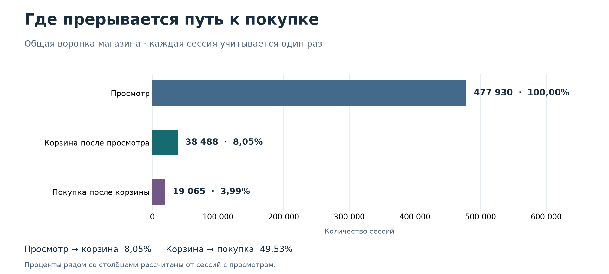

# Clickstream — обработка партий событий и воронка интернет-магазина

## Цель проекта

**Поддерживать правильную воронку покупателя при поступлении событий
частями, повторной доставке партии и появлении поздних событий.**

Аналитический результат помогает определить, на каком этапе прерывается
путь к покупке, и выделить категории для дальнейшей проверки по конверсии
и числу сессий без добавления в корзину.

На входе есть журнал просмотров, добавлений в корзину и покупок. По отдельным
строкам трудно понять, какой путь прошёл покупатель в рамках одного посещения.
Поэтому сначала нужно собрать действия в сессии и проверить их качество.

Анализ должен помочь принять конкретное решение — **на какую категорию
направить следующую проверку каталога и регистрации событий**. Для этого нужно
определить этап с наибольшим оттоком, затем найти категории с большим числом
сессий без корзины и низкой долей переходов.

Результат проекта — воспроизводимый пайплайн Python и PostgreSQL с журналом
партий, пересчётом затронутых сессий, проверками и графиками воронки.

## Как обрабатываются партии

1. CSV или ZIP читается построчно во временную таблицу. Проверяются структура,
   обязательные поля, типы, вид события и цена.
2. Партия регистрируется по постоянному ID и контрольной сумме содержимого.
   Повторная доставка даёт **0 новых строк**. Изменение содержимого под тем же ID
   вызывает ошибку.
3. В core пересчитываются затронутые сессии по всем их событиям в raw.
   Вставка raw, регистрация партии и изменение core выполняются одной транзакцией.
   Обычные представления mart читают обновлённый результат.

Пример обработки позднего события:

| Поступление | Время действий в сессии | Результат воронки |
|---|---|---|
| Первая партия | Просмотр в 10:00, покупка в 10:10 | Этап просмотра; предшествующей корзины пока нет |
| Поздняя партия | Корзина в 10:05 | Сессия доходит до покупки |
| Повтор поздней партии | Те же строки | 0 новых событий, прежний результат |

Параллельные загрузки и полная пересборка используют общую блокировку PostgreSQL.
Если позднее событие нарушает правила сессии, её прежние события исключаются
из core, а границы связанных пользователей и товаров пересчитываются.

### Как различаются доставки и действия покупателя

В исходнике отсутствует отдельный ID события. Здесь идентичность доставки
определяется парой **ID партии + номер записи внутри партии**. Одинаковые строки
внутри одной партии сохраняются как отдельные действия.

По умолчанию ID партии формируется из SHA-256 нормализованных значений записей
в исходном порядке. Переименование CSV и переупаковка в ZIP сохраняют этот ID.
Свой стабильный ID можно задать через `--batch-id`.

Разные явно заданные ID обозначают разные доставки, даже при одинаковом
содержимом. Перекрывающиеся файлы с разными ID требуют идентификатора события
от источника для межпартийного устранения повторов. Для одного прогона
используется один набор доставок; полный архив и его нарезка проверяются
в отдельных базах.

Исходный статический архив можно разделить на партии для воспроизведения
поступления данных. Даты действий берутся из источника, время доставки
фиксируется при загрузке.

**Проверено на полном архиве.** Девять партий дали 885 129 строк raw
и 806 078 событий core. Повтор всех партий добавил 0 строк.
Все девять таблиц и витрин совпали с полной пересборкой по всем колонкам.
21 интеграционный тест прошёл на PostgreSQL 15.
[Результаты и метод проверки](reports/batch-processing.md).

## Где прерывается путь к покупке

Из 100 сессий с просмотром примерно **8 доходят до корзины**, а всю цепочку
до покупки проходят примерно **4**. От просмотра к корзине не переходят
91,95% сессий; после корзины до покупки не доходят 50,47%.
Поэтому дальнейший разбор сосредоточен на переходе **просмотр → корзина**.

## Какие категории проверить первыми

Сравниваются **107 категорий с заполненными названиями**. Все технические ID
с одинаковым названием объединены. На графике показаны крупные категории
с конверсией ниже общей доли переходов по известным категориям — **9,45%**.
Выше расположены категории с большим числом сессий без последующей корзины.

**Первый кандидат по объёму сессий без корзины — телефоны.**
Из **49 264** сессий с просмотром этой категории в **4 261** появилась
последующая корзина той же категории. Конверсия — **8,65%**,
сессий без такого перехода — **45 003**. Среди пяти показанных категорий
самая низкая конверсия у телевизоров — **4,02%**, при 11 972 сессиях с просмотром.

**Следующее действие команды — проверить состав категории телефонов
и полноту регистрации событий корзины.** Затем можно проверять гипотезы
о цене, наличии и карточках товаров. Для проверки наличия и состояния
карточек понадобятся дополнительные данные.

Категории различаются ассортиментом и намерениями покупателей. Найденная
разница задаёт направление проверки. Чтобы установить её причины и оценить
эффект изменений, нужны дополнительные данные и отдельное исследование.

## Покрытие данных

| Название категории в событии | События после отбора сессий | Доля |
|---|---:|---:|
| Заполнено | 587 072 | 72,83% |
| Отсутствует | 219 006 | 27,17% |

Сравнение категорий описывает события с заполненным названием.
События с неизвестной категорией включены в общую воронку магазина.
Для восстановления их названий нужен дополнительный справочник товаров
или категорий. Проверка по другим событиям тех же товаров дала ноль
восстановленных названий.

Точные значения, правило отбора и ограничения сравнения

Полный расчёт повторён **2026-11-19** на 885 129 событиях за период
с 2020-09-24 по 2021-02-28. После отбора сессий осталось 806 078 событий.
В 107 известных категориях получилось 344 777 пар «сессия + название категории»
с просмотром. В 32 571 паре после просмотра появилась корзина этой категории — **9,45%**.

Для списка кандидатов выбраны категории с **не менее 1000 сессий
с просмотром** и конверсией **ниже 9,45%**. Они отсортированы по числу сессий
без последующей корзины. Порог 1000 — выбранный ориентир для рассмотрения
крупных групп; статистическая проверка различий остаётся отдельной задачей.

| Категория | Сессии с просмотром | Дошли до корзины | Без перехода к корзине | Конверсия |
|---|---:|---:|---:|---:|
| Телефоны | 49 264 | 4 261 | 45 003 | 8,65% |
| Картриджи | 23 684 | 2 215 | 21 469 | 9,35% |
| Акустика | 15 733 | 900 | 14 833 | 5,72% |
| Ноутбуки | 15 154 | 1 292 | 13 862 | 8,53% |
| Телевизоры | 11 972 | 481 | 11 491 | 4,02% |

### Как считается переход по категории

- Единица расчёта — пара `session_id + category_code` с хотя бы одним просмотром.
- Берётся первый просмотр и первая корзина **строго позже** этого просмотра
  в той же сессии и той же категории. Товары могут различаться.
- Повторные просмотры и корзины одной категории дают одну пару и один переход.
- Сессия, в которой просматривали две категории, участвует в обеих категориях.
- Группировка выполняется по заполненному `category_code`, например
  `electronics.telephone`. Разные `category_id` с одинаковым названием
  объединяются внутри сессии. Пробелы по краям названия удаляются.
- У события корзины тоже должно быть заполнено название той же категории.
  При отсутствии названия связь по категории установить невозможно.

| Наблюдаемые события одной сессии | Результат |
|---|---|
| Просмотр A → корзина B | У A просмотр без перехода. B входит в расчёт при наличии собственного просмотра |
| Просмотр A → просмотр B → корзина B | У A просмотр без перехода, у B переход к корзине |
| Просмотр A → просмотр A → корзина A → корзина A | Одна пара и один переход у A |
| Просмотр A и корзина A в одно время | Переход отсутствует, нужна корзина с более поздним временем |

Воронка магазина ниже считает каждую сессию один раз и даёт 8,05% переходов
от просмотра к корзине. Расчёт по известным категориям даёт 9,45% по парам
«сессия + название категории». Различаются единица расчёта, покрытие данных
и требование совпадения категории, поэтому складывать показатели категорий
для получения числа уникальных сессий магазина нельзя.

Результаты относятся к наблюдаемым событиям отобранных сессий за указанный
исторический период. Доля 27,17% относится ко всем событиям core;
доли переходов рассчитываются по парам сессия + название категории.

## Источник данных

Проект выполнен на открытых исторических данных о действиях покупателей.

[eCommerce events history in electronics store — Kaggle](https://www.kaggle.com/datasets/mkechinov/ecommerce-events-history-in-electronics-store).

В проекте используется архив events.csv.zip:
885 129 событий с действиями view, cart и purchase.

Исходные данные не включены в репозиторий.
Для запуска скачайте архив со страницы датасета
и поместите его в data/events.csv.zip.

## Архитектура

Стек — Python, psycopg, PostgreSQL 15, SQL, Docker Compose, Matplotlib.

    ZIP / CSV
        ↓ Python: потоковое чтение и COPY
    raw.events_import
        ↔ raw.import_batches — ID, контрольная сумма и состояние партии
        ↓ SQL: пересчёт затронутых сессий
    core.users / products / sessions / events
        ├─ SQL → mart.session_funnel → mart.funnel_summary
        └─ SQL → mart.session_category_funnel → mart.category_conversion

    core.events → mart.category_data_quality

- raw — исходные события с приведёнными типами данных,
  именем файла и временем загрузки.
- core — пользователи, товары, сессии и события,
  связанные первичными и внешними ключами.
- mart — представления с этапами сессионной воронки
  и сводными конверсиями магазина и категорий.

Загрузчик читает CSV построчно, без загрузки всего файла в память.
Проверяет заголовок, обязательные поля и преобразование типов.
Загрузка выполняется одной транзакцией: при ошибке изменения
откатываются.

## Результаты общей воронки

Результаты локального запуска на полном исходном файле, проверены 2026-11-19.

| Показатель | Количество |
|---|---:|
| События в raw | 885 129 |
| События в core | 806 078 |
| Исключённые события | 79 051 |
| Пользователи в core | 400 263 |
| Товары в core | 52 608 |
| Сессии в core | 479 958 |

### Воронка

| Этап | Сессии |
|---|---:|
| Просмотр | 477 930 |
| Корзина после просмотра | 38 488 |
| Покупка после корзины | 19 065 |

- Просмотр → корзина: 8,05%.
- Корзина → покупка: 49,53%.
- Просмотр → покупка: 3,99%.

Каждая сессия учитывается на этапе не более одного раза.
Знаменатель общей конверсии — сессии с просмотром.

## Правила обработки

В core включаются сессии, для которых:

- идентификатор сессии заполнен;
- все события относятся к одному пользователю;
- между первым и последним событием прошло не более 24 часов.

Сессии из одного события сохраняются.
Исключённые из core события остаются в raw.

Причины исключения:

| Причина | События |
|---|---:|
| Отсутствует идентификатор сессии | 165 |
| В сессии несколько пользователей | 1 527 |
| Длительность сессии превышает 24 часа | 78 578 |

Причины могут пересекаться, поэтому их количества нельзя
суммировать для получения общего числа исключённых событий.

## Логика воронки

Для каждой сессии определяются:

1. Первый просмотр.
2. Первое добавление в корзину строго после первого просмотра.
3. Первая покупка строго после найденного добавления в корзину.

funnel_stage показывает последний достигнутый этап:
view, cart, purchase или no_view.

### Ограничения

- Порог 24 часа — выбранное правило проекта.
  Он влияет на состав анализируемых сессий.
- Используется идентификатор сессии из источника.
  Новые сессии по интервалам неактивности не рассчитываются.
- Воронка строится по магазину в целом: товары на разных
  этапах могут отличаться.
- События с одинаковым временем не образуют переход:
  требуется строгое увеличение времени.
- Покупки без предшествующей цепочки просмотра и корзины
  не входят в последний этап воронки.
- Результаты описывают отобранные сессии данного файла.
- Витрины реализованы обычными VIEW и вычисляются при чтении.

## Структура проекта

    compose.yaml
    requirements.txt
    scripts/
        load_raw.py
        run_pipeline.py
        split_source.py
        plot_results.py
    tests/
        test_batches.py
    docs/images/
        session-funnel.png
        named-category-conversion.png
    sql/
        01_schema.sql
        02_build_core.sql
        03_quality_checks.sql
        04_build_marts.sql
        05_check_marts.sql
        06_category_conversion.sql
        07_check_category_conversion.sql
        08_enable_batches.sql
        09_refresh_sessions.sql

## Запуск

Понадобятся Python 3.10 или новее с pip, Docker Compose и SQL-клиент,
например DBeaver. Команды ниже приведены для Windows PowerShell
и выполняются из корня проекта.

### 1. Настройки и данные

Создайте локальный файл .env:

    POSTGRES_HOST=localhost
    POSTGRES_PORT=5433
    POSTGRES_DB=electronics_events
    POSTGRES_USER=electronics_user
    POSTGRES_PASSWORD=replace_with_your_local_password

Замените пример пароля своим значением.

Поместите исходный архив в data/events.csv.zip.
Архив должен содержать ровно один CSV с полями в таком порядке:

    event_time,event_type,product_id,category_id,category_code,brand,price,user_id,user_session

Формат времени: 2020-09-24 11:57:06 UTC.

Файлы .env, исходные данные и виртуальное окружение
исключены из Git через .gitignore.

### 2. Окружение

    python -m venv .venv
    .\.venv\Scripts\python.exe -m pip install -r requirements.txt
    docker compose up -d
    docker compose ps

Дождитесь статуса healthy у PostgreSQL.

### 3. Загрузка и пересчёт сессий

Запустите из корня проекта:

    .\.venv\Scripts\python.exe scripts/run_pipeline.py --source data/events.csv.zip

Команда создаёт схему и витрины при первом запуске, регистрирует партию,
загружает raw и обновляет core. Повтор той же команды показывает 0 новых строк.
Для отдельного файла с постоянным ID:

    .\.venv\Scripts\python.exe scripts/run_pipeline.py --source data/new-events.csv --batch-id delivery-001

Для другой базы можно передать файл настроек через `--env-file путь-к-файлу`.

Если в базе уже есть строки от прежнего загрузчика, сначала выполните команду
с полным исходным архивом. Загрузчик сверит все строки в исходном порядке,
сохранит их `raw_event_id` и зарегистрирует прежнюю загрузку как партию.
При несовпадении проверка завершится ошибкой с откатом.

Для работы только с raw доступен `scripts/load_raw.py` с теми же аргументами.
Следующий запуск `run_pipeline.py` обработает все ожидающие партии в core.

### 4. Воспроизведение загрузки по частям

Создайте отдельную базу в SQL-клиенте:

    CREATE DATABASE electronics_batches;

Создайте `data/batches.env` по образцу `.env` выше и укажите
`POSTGRES_DB=electronics_batches`. Разделите архив на файлы по 100 000 строк:

    .\.venv\Scripts\python.exe scripts/split_source.py

Скрипт создаёт `data/batches/` после успешной проверки всего источника.
Для другого каталога используйте `--output-dir`, для размера — `--rows-per-batch`.
Загрузите подготовленные партии:

    Get-ChildItem data/batches/batch-*.csv | Sort-Object Name | ForEach-Object {
        .\.venv\Scripts\python.exe scripts/run_pipeline.py --source $_.FullName --env-file data/batches.env
        if ($LASTEXITCODE -ne 0) { throw "Загрузка партии завершилась ошибкой" }
    }

Повторите этот цикл для проверки повторной доставки. Контрольные запросы
находятся в `03_quality_checks.sql`, `05_check_marts.sql` и
`07_check_category_conversion.sql`.

`02_build_core.sql` доступен для полной пересборки из raw и сверки результата.
`08_enable_batches.sql` — повторяемая миграция для старой схемы;
загрузчик применяет её автоматически. `09_refresh_sessions.sql` вызывается
загрузчиком в транзакции с таблицей затронутых сессий.

### Результаты в PostgreSQL

Результаты доступны запросами:

    SELECT * FROM mart.funnel_summary;

    SELECT funnel_stage, COUNT(*) AS session_count
    FROM mart.session_funnel
    GROUP BY funnel_stage
    ORDER BY session_count DESC;

Полная таблица категорий доступна запросом:

    SELECT *
    FROM mart.category_conversion
    ORDER BY sessions_without_cart DESC, category_code;

Покрытие названиями категорий доступно запросом:

    SELECT * FROM mart.category_data_quality;

В конце `06_category_conversion.sql` находятся запросы для десяти крупнейших
групп по числу сессий без корзины и для пяти кандидатов из таблицы выше.

### 5. Графики

После построения витрин выполните из корня проекта:

    .\.venv\Scripts\python.exe scripts/plot_results.py

Скрипт использует настройки `.env`, читает витрины `mart.funnel_summary`
и `mart.category_conversion`, получает покрытие из `mart.category_data_quality`
и сохраняет два PNG в `docs/images/`.
При обновлении данных повторите расчёт витрин и эту команду.

## Проверки

Интеграционные тесты создают отдельные временные базы PostgreSQL.
Подключение с правом `CREATE DATABASE` задаётся через `TEST_DATABASE_URL`:

    $env:TEST_DATABASE_URL = "host=localhost port=5433 dbname=postgres user=electronics_user password=ваш_локальный_пароль"
    .\.venv\Scripts\python.exe -m unittest discover -s tests -v

Проверяются повторная доставка, изменение содержимого под прежним ID,
поздняя корзина, сохранение одинаковых действий, откат при ошибке,
параллельная доставка, перенос прежней загрузки и совпадение с полной пересборкой.

03_quality_checks.sql показывает баланс событий между слоями,
причины исключения и сверяет сведения о сессиях с событиями core.

05_check_marts.sql проверяет:

- отсутствие пропущенных и лишних сессий;
- отсутствие дублей сессий;
- хронологический порядок этапов.

На полном файле все счётчики несоответствий дали 0.
Проверки возвращают SQL-результаты для просмотра;
автоматическое завершение процесса с ошибкой не реализовано.

`07_check_category_conversion.sql` проверяет полноту и уникальность пар
«сессия + категория», время первого просмотра и подходящей корзины,
порядок действий, согласованность счётчиков, заполненность названий
и покрытие исходных событий.
Ожидаемые времена дополнительно рассчитываются оконной функцией по событиям.
На полном файле все счётчики несоответствий дали 0.

Перед полным расчётом на примере из 23 событий проверены десять сценариев,
включая объединение разных ID по одному названию, корзину другой категории,
повторы, корзину до просмотра, равные времена и пропущенные названия.
Независимый подсчёт исходного CSV подтвердил количество просмотровых пар
и переходов к корзине во всех 107 известных категориях.

## Повторный запуск

- Повтор партии с прежним ID и содержимым даёт 0 новых строк.
- Новый ID обозначает новую доставку.
- 01_schema.sql предназначен для первоначального создания таблиц.
- 02_build_core.sql полностью пересобирает core из сохранённого raw.
- 04_build_marts.sql пересоздаёт представления.
- 06_category_conversion.sql пересоздаёт представления по категориям.
- После пересборки следует повторить проверки.

Новые партии пересчитывают затронутые сессии и связанные с ними сущности.
