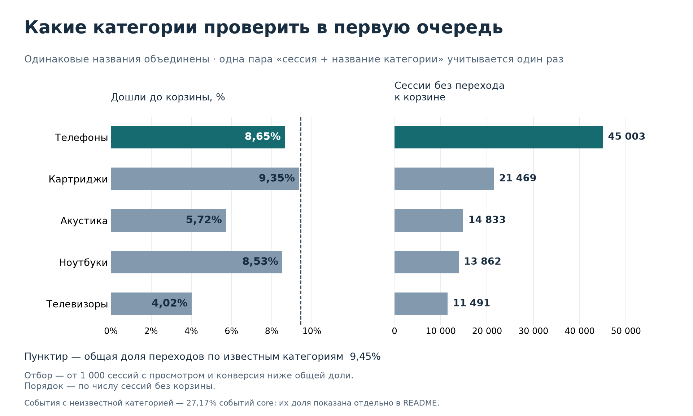

# Clickstream — воронка интернет-магазина и переход к корзине по категориям

## Задача

Учебный сценарий — команде интернет-магазина нужно выбрать,
**какие категории товаров проверить в первую очередь, чтобы разобраться,
почему просмотры редко переходят в добавление в корзину**.

На входе есть журнал просмотров, добавлений в корзину и покупок. По отдельным
строкам трудно понять, какой путь прошёл покупатель в рамках одного посещения.
Поэтому сначала нужно собрать действия в сессии и проверить их качество.

Анализ должен помочь принять конкретное решение — **на какую категорию
направить следующую проверку каталога и регистрации событий**. Для этого нужно
определить этап с наибольшим оттоком, затем найти категории с большим числом
сессий без корзины и низкой долей переходов.

Результат проекта — воспроизводимый расчёт в PostgreSQL, два графика и список
категорий с обоснованием приоритета. Данные относятся к открытому историческому
набору, постановка задачи учебная.

## Где прерывается путь к покупке

Из 100 сессий с просмотром примерно **8 доходят до корзины**, а всю цепочку
до покупки проходят примерно **4**. От просмотра к корзине не переходят
91,95% сессий; после корзины до покупки не доходят 50,47%.
Поэтому дальнейший разбор сосредоточен на переходе **просмотр → корзина**.

## Какие категории проверить первыми

Сравниваются **107 категорий с заполненными названиями**. Все технические ID
с одинаковым названием объединены. На графике показаны крупные категории
с конверсией ниже общей доли переходов по известным категориям — **9,45%**.
Выше расположены категории с большим числом сессий без последующей корзины.

**Первый кандидат по объёму сессий без корзины — телефоны.**
Из **49 264** сессий с просмотром этой категории в **4 261** появилась
последующая корзина той же категории. Конверсия — **8,65%**,
сессий без такого перехода — **45 003**. Среди пяти показанных категорий
самая низкая конверсия у телевизоров — **4,02%**, при 11 972 сессиях с просмотром.

**Следующее действие команды — проверить состав категории телефонов
и полноту регистрации событий корзины.** Затем можно проверять гипотезы
о цене, наличии и карточках товаров. Для проверки наличия и состояния
карточек понадобятся дополнительные данные.

Категории различаются ассортиментом и намерениями покупателей. Найденная
разница задаёт направление проверки. Чтобы установить её причины и оценить
эффект изменений, нужны дополнительные данные и отдельное исследование.

## Покрытие данных

| Название категории в событии | События после отбора сессий | Доля |
|---|---:|---:|
| Заполнено | 587 072 | 72,83% |
| Отсутствует | 219 006 | 27,17% |

Сравнение категорий описывает события с заполненным названием.
События с неизвестной категорией включены в общую воронку магазина.
Для восстановления их названий нужен дополнительный справочник товаров
или категорий. Проверка по другим событиям тех же товаров дала ноль
восстановленных названий.

Точные значения, правило отбора и ограничения сравнения

Полный расчёт повторён **2026-11-19** на 885 129 событиях за период
с 2020-09-24 по 2021-02-28. После отбора сессий осталось 806 078 событий.
В 107 известных категориях получилось 344 777 пар «сессия + название категории»
с просмотром. В 32 571 паре после просмотра появилась корзина этой категории — **9,45%**.

Для списка кандидатов выбраны категории с **не менее 1000 сессий
с просмотром** и конверсией **ниже 9,45%**. Они отсортированы по числу сессий
без последующей корзины. Порог 1000 — выбранный ориентир для рассмотрения
крупных групп; статистическая проверка различий остаётся отдельной задачей.

| Категория | Сессии с просмотром | Дошли до корзины | Без перехода к корзине | Конверсия |
|---|---:|---:|---:|---:|
| Телефоны | 49 264 | 4 261 | 45 003 | 8,65% |
| Картриджи | 23 684 | 2 215 | 21 469 | 9,35% |
| Акустика | 15 733 | 900 | 14 833 | 5,72% |
| Ноутбуки | 15 154 | 1 292 | 13 862 | 8,53% |
| Телевизоры | 11 972 | 481 | 11 491 | 4,02% |

### Как считается переход по категории

- Единица расчёта — пара `session_id + category_code` с хотя бы одним просмотром.
- Берётся первый просмотр и первая корзина **строго позже** этого просмотра
  в той же сессии и той же категории. Товары могут различаться.
- Повторные просмотры и корзины одной категории дают одну пару и один переход.
- Сессия, в которой просматривали две категории, участвует в обеих категориях.
- Группировка выполняется по заполненному `category_code`, например
  `electronics.telephone`. Разные `category_id` с одинаковым названием
  объединяются внутри сессии. Пробелы по краям названия удаляются.
- У события корзины тоже должно быть заполнено название той же категории.
  При отсутствии названия связь по категории установить невозможно.

| Наблюдаемые события одной сессии | Результат |
|---|---|
| Просмотр A → корзина B | У A просмотр без перехода. B входит в расчёт при наличии собственного просмотра |
| Просмотр A → просмотр B → корзина B | У A просмотр без перехода, у B переход к корзине |
| Просмотр A → просмотр A → корзина A → корзина A | Одна пара и один переход у A |
| Просмотр A и корзина A в одно время | Переход отсутствует, нужна корзина с более поздним временем |

Воронка магазина ниже считает каждую сессию один раз и даёт 8,05% переходов
от просмотра к корзине. Расчёт по известным категориям даёт 9,45% по парам
«сессия + название категории». Различаются единица расчёта, покрытие данных
и требование совпадения категории, поэтому складывать показатели категорий
для получения числа уникальных сессий магазина нельзя.

Результаты относятся к наблюдаемым событиям отобранных сессий за указанный
исторический период. Доля 27,17% относится ко всем событиям core;
доли переходов рассчитываются по парам сессия + название категории.

## Источник данных

[eCommerce events history in electronics store — Kaggle](https://www.kaggle.com/datasets/mkechinov/ecommerce-events-history-in-electronics-store).

В проекте используется архив events.csv.zip:
885 129 событий с действиями view, cart и purchase.

Исходные данные не включены в репозиторий.
Для запуска скачайте архив со страницы датасета
и поместите его в data/events.csv.zip.

## Архитектура

Стек — Python, psycopg, PostgreSQL 15, SQL, Docker Compose, Matplotlib.

    ZIP / CSV
        ↓ Python: потоковое чтение и COPY
    raw.events_import
        ↓ SQL: отбор сессий и преобразование данных
    core.users / products / sessions / events
        ├─ SQL → mart.session_funnel → mart.funnel_summary
        └─ SQL → mart.session_category_funnel → mart.category_conversion

    core.events → mart.category_data_quality

- raw — исходные события с приведёнными типами данных,
  именем файла и временем загрузки.
- core — пользователи, товары, сессии и события,
  связанные первичными и внешними ключами.
- mart — представления с этапами сессионной воронки
  и сводными конверсиями магазина и категорий.

Загрузчик читает CSV построчно, без загрузки всего файла в память.
Проверяет заголовок, обязательные поля и преобразование типов.
Загрузка выполняется одной транзакцией: при ошибке изменения
откатываются.

## Результаты общей воронки

Результаты локального запуска на полном исходном файле, проверены 2026-11-19.

| Показатель | Количество |
|---|---:|
| События в raw | 885 129 |
| События в core | 806 078 |
| Исключённые события | 79 051 |
| Пользователи в core | 400 263 |
| Товары в core | 52 608 |
| Сессии в core | 479 958 |

### Воронка

| Этап | Сессии |
|---|---:|
| Просмотр | 477 930 |
| Корзина после просмотра | 38 488 |
| Покупка после корзины | 19 065 |

- Просмотр → корзина: 8,05%.
- Корзина → покупка: 49,53%.
- Просмотр → покупка: 3,99%.

Каждая сессия учитывается на этапе не более одного раза.
Знаменатель общей конверсии — сессии с просмотром.

## Правила обработки

В core включаются сессии, для которых:

- идентификатор сессии заполнен;
- все события относятся к одному пользователю;
- между первым и последним событием прошло не более 24 часов.

Сессии из одного события сохраняются.
Исключённые из core события остаются в raw.

Причины исключения:

| Причина | События |
|---|---:|
| Отсутствует идентификатор сессии | 165 |
| В сессии несколько пользователей | 1 527 |
| Длительность сессии превышает 24 часа | 78 578 |

Причины могут пересекаться, поэтому их количества нельзя
суммировать для получения общего числа исключённых событий.

## Логика воронки

Для каждой сессии определяются:

1. Первый просмотр.
2. Первое добавление в корзину строго после первого просмотра.
3. Первая покупка строго после найденного добавления в корзину.

funnel_stage показывает последний достигнутый этап:
view, cart, purchase или no_view.

### Ограничения

- Порог 24 часа — выбранное правило проекта.
  Он влияет на состав анализируемых сессий.
- Используется идентификатор сессии из источника.
  Новые сессии по интервалам неактивности не рассчитываются.
- Воронка строится по магазину в целом: товары на разных
  этапах могут отличаться.
- События с одинаковым временем не образуют переход:
  требуется строгое увеличение времени.
- Покупки без предшествующей цепочки просмотра и корзины
  не входят в последний этап воронки.
- Результаты описывают отобранные сессии данного файла.
- Витрины реализованы обычными VIEW и вычисляются при чтении.

## Структура проекта

    compose.yaml
    requirements.txt
    scripts/
        load_raw.py
        plot_results.py
    docs/images/
        session-funnel.png
        category-conversion.png
    sql/
        01_schema.sql
        02_build_core.sql
        03_quality_checks.sql
        04_build_marts.sql
        05_check_marts.sql
        06_category_conversion.sql
        07_check_category_conversion.sql

## Запуск

Понадобятся Python 3.10 или новее с pip, Docker Compose и SQL-клиент,
например DBeaver. Команды ниже приведены для Windows PowerShell
и выполняются из корня проекта.

### 1. Настройки и данные

Создайте локальный файл .env:

    POSTGRES_HOST=localhost
    POSTGRES_PORT=5433
    POSTGRES_DB=electronics_events
    POSTGRES_USER=electronics_user
    POSTGRES_PASSWORD=replace_with_your_local_password

Замените пример пароля своим значением.

Поместите исходный архив в data/events.csv.zip.
Архив должен содержать ровно один CSV с полями в таком порядке:

    event_time,event_type,product_id,category_id,category_code,brand,price,user_id,user_session

Формат времени: 2020-09-24 11:57:06 UTC.

Файлы .env, исходные данные и виртуальное окружение
исключены из Git через .gitignore.

### 2. Окружение

    python -m venv .venv
    .\.venv\Scripts\python.exe -m pip install -r requirements.txt
    docker compose up -d
    docker compose ps

Дождитесь статуса healthy у PostgreSQL.

### 3. Схема и загрузка

Подключитесь к PostgreSQL через DBeaver:
localhost:5433, база и учётные данные — из .env.

Выполните целиком sql/01_schema.sql в пустой базе.
Затем запустите загрузчик из PowerShell:

    .\.venv\Scripts\python.exe scripts/load_raw.py

### 4. Преобразование и витрины

В той же базе выполните SQL-файлы целиком по порядку:

1. sql/02_build_core.sql
2. sql/03_quality_checks.sql
3. sql/04_build_marts.sql
4. sql/05_check_marts.sql
5. sql/06_category_conversion.sql
6. sql/07_check_category_conversion.sql

Если слои raw и core уже заполнены, для добавления расчёта по категориям
достаточно выполнить `06_category_conversion.sql` и `07_check_category_conversion.sql`.

Результаты доступны запросами:

    SELECT * FROM mart.funnel_summary;

    SELECT funnel_stage, COUNT(*) AS session_count
    FROM mart.session_funnel
    GROUP BY funnel_stage
    ORDER BY session_count DESC;

Полная таблица категорий доступна запросом:

    SELECT *
    FROM mart.category_conversion
    ORDER BY sessions_without_cart DESC, category_code;

Покрытие названиями категорий доступно запросом:

    SELECT * FROM mart.category_data_quality;

В конце `06_category_conversion.sql` находятся запросы для десяти крупнейших
групп по числу сессий без корзины и для пяти кандидатов из таблицы выше.

### 5. Графики

После построения витрин выполните из корня проекта:

    .\.venv\Scripts\python.exe scripts/plot_results.py

Скрипт использует настройки `.env`, читает витрины `mart.funnel_summary`
и `mart.category_conversion`, получает покрытие из `mart.category_data_quality`
и сохраняет два PNG в `docs/images/`.
При обновлении данных повторите расчёт витрин и эту команду.

## Проверки

03_quality_checks.sql показывает баланс событий между слоями,
причины исключения и сверяет сведения о сессиях с событиями core.

05_check_marts.sql проверяет:

- отсутствие пропущенных и лишних сессий;
- отсутствие дублей сессий;
- хронологический порядок этапов.

На полном файле все счётчики несоответствий дали 0.
Проверки возвращают SQL-результаты для просмотра;
автоматическое завершение процесса с ошибкой не реализовано.

`07_check_category_conversion.sql` проверяет полноту и уникальность пар
«сессия + категория», время первого просмотра и подходящей корзины,
порядок действий, согласованность счётчиков, заполненность названий
и покрытие исходных событий.
Ожидаемые времена дополнительно рассчитываются оконной функцией по событиям.
На полном файле все счётчики несоответствий дали 0.

Перед полным расчётом на примере из 23 событий проверены десять сценариев,
включая объединение разных ID по одному названию, корзину другой категории,
повторы, корзину до просмотра, равные времена и пропущенные названия.
Независимый подсчёт исходного CSV подтвердил количество просмотровых пар
и переходов к корзине во всех 107 известных категориях.

## Повторный запуск

- Загрузчик отменяет загрузку, если raw уже содержит данные.
- 01_schema.sql предназначен для первоначального создания таблиц.
- 02_build_core.sql полностью пересобирает core из сохранённого raw.
- 04_build_marts.sql пересоздаёт представления.
- 06_category_conversion.sql пересоздаёт представления по категориям.
- После пересборки следует повторить проверки.

Инкрементальная загрузка в этой версии не реализована.
