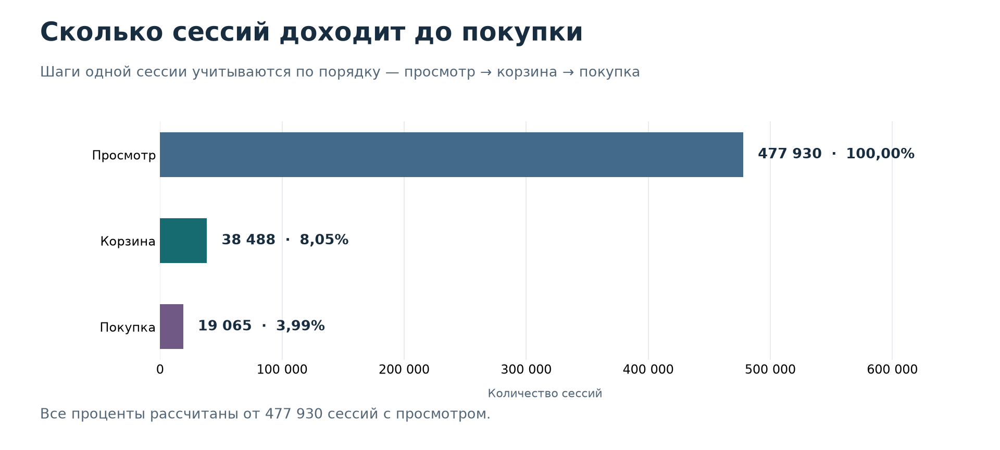
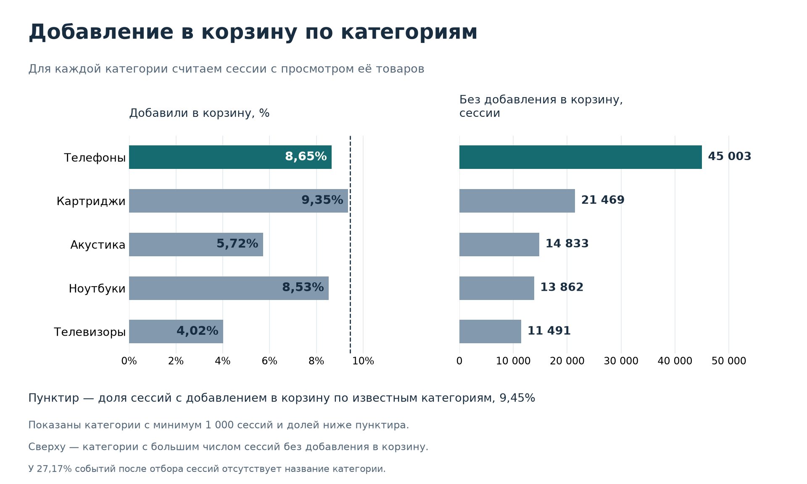

# Clickstream — пайплайн событий интернет-магазина

[English version](https://github.com/YaraBykova/ecommerce-clickstream-pipeline-en)

## Цель проекта

Получать корректную воронку «просмотр → корзина → покупка» при загрузке
данных партиями, повторной доставке файлов и поздних событиях.

Главный вопрос анализа — **на каком шаге прерывается путь к покупке
и какие категории товаров стоит проверить подробнее?**

**Стек — Python, PostgreSQL, SQL, Docker Compose, Matplotlib.**

## Сколько сессий доходит до покупки

До корзины доходят **8,05%** сессий с просмотром, всю цепочку до покупки
проходят **3,99%**. Самая большая доля потерь приходится на переход
от просмотра к корзине, поэтому дальше сравниваются категории на этом шаге.

Одна сессия — одно посещение магазина. Если за него произошли просмотр,
добавление в корзину и покупка, оно учитывается во всех трёх столбцах.
Проценты на графике рассчитаны от сессий с просмотром.

## Добавление в корзину по категориям

Сравниваются **107 категорий с заполненным названием**. Общая доля сессий
с добавлением в корзину по этим категориям составляет **9,45%**.
На графике показаны пять категорий, отобранных по правилам ниже.

По выбранному правилу первыми для проверки оказались **телефоны**.
Из 49 264 сессий с просмотром этой категории в 4 261 добавили товар в корзину —
**8,65%**. В 45 003 сессиях такого перехода нет.

Следующее действие — проверить состав категории и полноту регистрации
событий корзины. Для исследования причин различий понадобятся дополнительные
сведения о товарах и работе магазина.

## Методика

1. Используем сессии из источника. В расчёт включаются сессии с заполненным ID,
   одним пользователем и длительностью до 24 часов включительно.
2. Внутри сессии ищем первый просмотр, затем первую корзину и покупку в этом
   порядке. Время каждого следующего действия должно быть строго позже предыдущего.
   На каждом этапе сессия учитывается один раз.
3. В общей воронке проценты считаются от **477 930 сессий с просмотром**.
4. Категории объединяем по заполненному названию. Для каждой пары
   «сессия + категория» с просмотром проверяем, было ли затем добавление
   в корзину этой категории. Одна сессия может участвовать в нескольких категориях.
5. Отбираем категории с минимум **1000 сессий с просмотром** и долей переходов
   ниже **9,45%**. Сортируем их по числу сессий без добавления в корзину.

Порог 1000 выбран для рассмотрения крупных групп. Такой отбор задаёт
направление дальнейшей проверки. Статистическая значимость различий отдельно
не оценивалась.

Подробные правила, таблицы и примеры расчёта доступны в
[методике](docs/methodology.md).

## Данные и ограничения

Использованы **885 129 событий** магазина за 24.09.2020–28.02.2021.
После отбора сессий в расчёт вошло **806 078 событий**.
[Источник на Kaggle](https://www.kaggle.com/datasets/mkechinov/ecommerce-events-history-in-electronics-store).

- У **27,17%** событий после отбора сессий отсутствует название категории.
  Они участвуют в общей воронке. Сравнение категорий относится к именованной части.
- Товары на разных шагах воронки могут различаться.
- Общая воронка считает сессии, а сравнение категорий — пары «сессия + категория».
  Их показатели имеют разные основания расчёта.
- Причины различий конверсии требуют отдельного исследования.

## Как устроен пайплайн

CSV и ZIP проходят путь **Python → PostgreSQL → витрины → графики**.
Исходные события сохраняются в raw, принятые сессии и связанные сущности —
в core, аналитические расчёты — в mart.

Загрузчик регистрирует каждую партию. Повторная доставка добавляет 0 строк,
а позднее событие приводит к пересчёту затронутых сессий.
При ошибке загрузка и связанные изменения в базе откатываются.

Идентичность доставки определяется ID партии и номером записи.
Для устранения пересечений между разными партиями нужен ID события от источника.

## Как проверена работа

| Проверка | Результат |
|---|---|
| Загрузка полного архива | 885 129 событий, 9 партий |
| Повторная доставка всех партий | 0 новых строк |
| Сравнение с полной пересборкой | 0 расхождений в 9 таблицах и витринах |
| Интеграционные тесты PostgreSQL | 21 тест прошёл |

Подробности полного прогона и проверенных случаев приведены в
[отчёте о партиях и поздних событиях](reports/batch-processing.md).

## Как воспроизвести результат

Подготовка данных, настройки PostgreSQL, команды загрузки, построения графиков
и запуска тестов собраны в [инструкции запуска](docs/setup.md).
